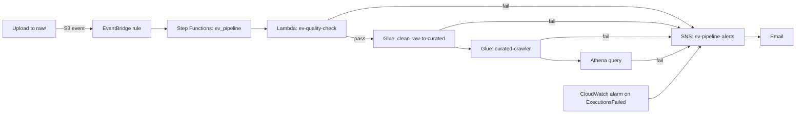

# EV Data Lake on AWS

An end-to-end data engineering and AI project on AWS. It takes a real Washington State electric vehicle registration dataset from raw upload to validated, cataloged, queryable data, then adds AI services on top. It was built in five stages, one per day.

## Project Overview

| Day | Focus | Key AWS Services |
|---|---|---|
| 1 | Storage, access control, and cost controls | S3, IAM, STS, AWS Budgets |
| 2 | Cleaning and cataloging with Spark | S3, Glue (Data Catalog, Crawlers, ETL), IAM |
| 3 | SQL analytics and pipeline orchestration | Athena, Glue, Step Functions, S3, IAM |
| 4 | Automated, validated pipeline with alerts | Lambda, SNS, EventBridge, CloudWatch, Step Functions |
| 5 | Generative AI and pre-built AI services | Bedrock, SageMaker (evaluated), Comprehend |

### Dataset

- **Source:** Washington State Clean Vehicle registrations (`export.csv`)
- **Size:** about 78 MiB (82.2 MB), 300,142 data rows, 16 columns
- **Key columns:** `VIN (1-10)`, `Model Year`, `Make`, `Model`, `Electric Vehicle Type`, `Electric Range`, `DOL Vehicle ID`, `2020 GEOID`

The dataset has no date column, so the data is partitioned by `model_year` instead of year and month.

## Architecture



### S3 Data Lake Layout

| Prefix | Purpose |
|---|---|
| `raw/` | Untouched source files. Objects move to STANDARD_IA after 30 days. |
| `curated/` | Cleaned Parquet data, partitioned by `model_year`. |
| `scripts/` | Code and job artifacts. |
| `athena-results/` | Athena query output, kept apart from `raw/` and `curated/` so crawlers never read it. |

## Repository Structure

```
.
├── upload_raw.py                    # Day 1: boto3 upload of the CSV to raw/
├── curated-readonly-policy.json     # Day 1: read-only permissions for curated/
├── lifecycle.json                   # Day 1: raw/ to STANDARD_IA after 30 days
├── glue_clean_raw_to_curated.py     # Day 2/4: Spark cleaning job
├── athena_queries.sql               # Day 3: table DDL and named queries
├── state_machine_day3.json          # Day 3: pipeline definition
├── state_machine_day4.json          # Day 4: validated pipeline with failure alerts
├── stepfunctions-pipeline-role-policy.json  # Day 3/4: pipeline role permissions
├── ev-raw-upload-trigger.json       # Day 4: EventBridge rule for uploads to raw/
├── quality_check/
│   ├── lambda_function.py           # Day 4: data quality checks
│   └── read-raw-only-policy.json    # Day 4: Lambda role, read raw/ only
├── ai/
│   ├── bedrock_hello.py             # Day 5: reusable Bedrock converse() helper
│   ├── tasks.py                     # Day 5: summarization, classification, JSON extraction
│   └── compare_models.py            # Day 5: two-model latency and cost comparison
├── notes.md                         # Write-up and learnings
└── *.png                            # Screenshots and evidence
```

## Prerequisites

- AWS account
- Python 3.14 (3.12 or later should also work)
- AWS CLI v2
- Git and GitHub
- Git Bash on Windows (or any Bash shell)

Set up a Python environment from the project root:

```bash
python -m venv .venv
source .venv/Scripts/activate     # Windows Git Bash
# source .venv/bin/activate       # macOS/Linux
pip install boto3
```

## Configuration

Credentials are never stored in the repository. Create a named AWS CLI profile:

```bash
aws configure --profile data-engineer
```

The profile is saved in `~/.aws/credentials` and `~/.aws/config`, outside the project folder.

Set the environment variables used by the scripts. Replace the placeholders with your values:

```bash
export ACCOUNT_ID=<ACCOUNT_ID>
export BUCKET=<BUCKET>
```

Verify the identity the CLI is using. It should show an IAM user or role, not root:

```bash
aws sts get-caller-identity --profile data-engineer
```

## Day 1: Storage and Access Control

**Goal:** build a small data lake in S3, upload a real dataset with code, and prove that access control works.

**What was built**

- A $5 monthly cost budget in AWS Budgets.
- An S3 bucket in `us-east-1` with default encryption and Block Public Access enabled.
- The `raw/`, `curated/`, and `scripts/` prefixes.
- `upload_raw.py`, which uploads the CSV to `raw/` with boto3. It reads the bucket from an environment variable and uses a named profile instead of hardcoded keys.
- The `curated-readonly` IAM role. Its permission policy allows listing and reading `curated/` only, and its trust policy allows the account to assume it.
- A lifecycle rule that moves `raw/` objects to STANDARD_IA after 30 days.

**Verification**

Assume the `curated-readonly` role with temporary credentials, then check the permissions:

```bash
aws s3 ls s3://$BUCKET/curated/     # succeeds
aws s3 ls s3://$BUCKET/raw/         # AccessDenied
```

**Commands**

```bash
python upload_raw.py export.csv

aws iam create-role --role-name curated-readonly \
  --assume-role-policy-document file://trust.json --profile data-engineer

aws iam put-role-policy --role-name curated-readonly \
  --policy-name curated-readonly \
  --policy-document file://curated-readonly-policy.json --profile data-engineer

aws s3api put-bucket-lifecycle-configuration --bucket $BUCKET \
  --lifecycle-configuration file://lifecycle.json --profile data-engineer

aws s3api get-bucket-lifecycle-configuration --bucket $BUCKET --profile data-engineer
```

**Key concepts**

- **Trust policy:** who may assume the role.
- **Permission policy:** what the role may do.
- **Least privilege:** each identity gets only the access its job needs.

## Day 2: Cleaning and Cataloging with Glue

**Goal:** clean the raw CSV with a Spark job and write partitioned Parquet to `curated/`.

**Inspection**

```bash
head -n 3 export.csv
wc -l export.csv
```

**Glue resources**

- Database: `ev-db`
- Crawler: `raw-crawler` (scans `raw/`)
- Crawler: `curated-crawler` (scans `curated/` and registers the `curated` table and `model_year` partitions)
- Job: `clean-raw-to-curated` (Spark, Glue 4.x or 5.x)

**What the cleaning job does**

1. Reads the CSV with headers, quotes, and multi-line values handled.
2. Converts column names to snake_case with a regex, so `VIN (1-10)` becomes `vin_1_10`.
3. Casts `model_year`, `electric_range`, `legislative_district`, and `dol_vehicle_id` to numeric types.
4. Removes exact duplicate rows, then duplicate vehicle IDs.
5. Writes Parquet partitioned by `model_year`.

**Results**

| Dataset | Objects | Size |
|---|---|---|
| Raw CSV (`raw/export.csv`) | 1 | 78.4 MiB |
| Curated Parquet (`curated/`) | 655 | 12.8 MiB |

The curated data is about 84% smaller than the raw CSV. The 655 files come from one folder per `model_year`, so fewer, larger files would perform better in Athena.

**Verification**

```bash
aws glue get-databases --profile data-engineer
aws glue get-tables --database-name ev-db --profile data-engineer
aws s3 ls s3://$BUCKET/curated/ --recursive --summarize --profile data-engineer | tail -n 2
```

## Day 3: SQL Analytics and Orchestration

**Goal:** query the curated data with Athena, measure the cost effect of the file format, and chain the steps into a Step Functions pipeline.

**Athena setup**

- Query result location: `s3://<BUCKET>/athena-results/`
- Catalog: `AwsDataCatalog`, database `ev-db`
- Table names must be double-quoted because of the hyphen, for example `"ev-db"."curated"`.

**Tables**

- `"ev-db"."raw_csv"`: an external table defined in `athena_queries.sql` over the CSV in `raw/`. The crawler did not create a table for the raw data, so the DDL creates it.
- `"ev-db"."curated"`: the Parquet table registered by `curated-crawler`.

**Cost comparison**

The same `make` aggregation was run against both tables:

| Table | Format | Data scanned | Run time |
|---|---|---|---|
| `raw_csv` | CSV | 78.36 MB | 1.463 s |
| `curated` | Parquet | 316.88 KB | 1.551 s |

Parquet scanned about 250 times less data. Athena bills by data scanned, so this is the cost lever. Run times were similar because the dataset is small, and Athena's 10 MB minimum billing per query hides the cost gap at this size. The gap grows with data volume.

**Named queries** (`athena_queries.sql`)

- `top10_makes`: top 10 makes by vehicle count
- `by_model_year`: vehicles by model year. This replaces a monthly trend, since the dataset has no date column.
- `range_outliers`: vehicles above the 99th percentile of electric range

**Pipeline** (`state_machine_day3.json`, state machine `ev_pipeline`)

1. Run the Glue cleaning job and wait for it to finish (`startJobRun.sync`).
2. Start `curated-crawler`.
3. Wait 180 seconds for the crawler.
4. Run the `make` aggregation in Athena (`startQueryExecution.sync`).
5. Succeed, or fail on any error.

The execution role is `stepfunctions-pipeline-role`, with trust for `states.amazonaws.com`.

## Day 4: Validated, Automated Pipeline with Alerts

**Goal:** run the pipeline automatically when a file arrives, reject bad files before cleaning, and send an alert when something fails.

**Data quality checks** (`quality_check/lambda_function.py`)

The `ev-quality-check` Lambda runs before any cleaning and checks:

1. The required columns exist: `VIN (1-10)`, `Model Year`, `DOL Vehicle ID`.
2. At least one data row exists.
3. The key columns are not blank.
4. There are no duplicate `DOL Vehicle ID` values.

Any failed check raises an error, which routes the pipeline to the alert path. On the real file, the Lambda returned `rows: 300142` with 0 duplicate IDs and 0 blank IDs.

**Pipeline changes**

- The validation Lambda runs first. The Glue job now receives the file path through `--INPUT_PATH` and reads that file directly from S3.
- Every failure state routes to `NotifyFailure`, which publishes to SNS.

**Alerting**

- SNS topic: `ev-pipeline-alerts`, with an email subscription.
- CloudWatch alarm `ev-pipeline-failed` on the `ExecutionsFailed` metric. The metric exists only after the first failed execution, so the alarm was created after that point.

**Automatic trigger** (`ev-raw-upload-trigger.json`)

An EventBridge rule matches S3 "Object Created" events under `raw/` and starts `ev_pipeline`. S3 event notifications must be enabled on the bucket for the rule to receive events.

**IAM roles**

| Role | Trusted by | Permissions | Purpose |
|---|---|---|---|
| `quality-check-lambda-role` | Lambda | Basic logging, `s3:GetObject` on `raw/*` | Runs the data checks only |
| `glue-etl-role` | Glue | Read `raw/*`, read and write `curated/*` | Cleaning job and crawlers |
| `stepfunctions-pipeline-role` | Step Functions | Invoke `ev-quality-check`, publish to SNS, run Glue and Athena | Orchestrates the pipeline |

**Test cases**

| Input | Expected result |
|---|---|
| Good file (`export.csv`) | Validation passes, curated data is written, pipeline succeeds |
| Header-only file | Validation fails with "no data rows", alert is sent, curated data is unchanged |
| Wrong columns | Validation fails with "missing columns", alert is sent, curated data is unchanged |

## Day 5: Generative AI and Pre-built AI Services

**Goal:** call foundation models through Amazon Bedrock, compare two models, evaluate SageMaker hosting, and use a pre-built AI service.

**Model selection**

The Bedrock model `anthropic.claude-haiku-5-5` is invoked through its US inference profile, `us.anthropic.claude-haiku-5-5`, because on-demand invocation is not supported for the base model ID. Find available profiles with:

```bash
aws bedrock list-inference-profiles --region us-east-1 --profile data-engineer
```

**Scripts**

- `ai/bedrock_hello.py`: a reusable `ask(model_id, system, user)` function that calls the Bedrock `converse` API and returns the text, latency, and token counts.
- `ai/tasks.py`: three tasks with a system prompt, summarization, classification of vehicle types, and structured JSON extraction. The JSON output is checked by parsing it.
- `ai/compare_models.py`: runs five prompts on two models and prints a table of latency, token counts, and estimated cost. Set the `PRICES` dictionary from the current Bedrock pricing page.

**Comprehend**

```bash
aws comprehend detect-sentiment \
  --text "The new charging station at the library works well and is easy to use." \
  --language-code en --region us-east-1 --profile data-engineer
```

**SageMaker**

JumpStart was evaluated for hosting a small open model. The pages in this account showed notebook-based deployment and GPU instance types that require quota, so no endpoint was deployed. SageMaker would be the choice for hosting custom or fine-tuned models with control over the runtime, at the cost of always-on instance charges during use.

**When to use each service**

| Service | Use it when | Example |
|---|---|---|
| Bedrock | You need summaries, classification, or extraction with managed foundation models, and no training or hosting | Classify EV registration records |
| SageMaker | You need a custom or fine-tuned model, or control over hosting, and can justify always-on cost | Fine-tune a model on utility data |
| Pre-built services (Comprehend, Textract, Rekognition) | The task is standard, such as sentiment or text extraction | Detect sentiment in public comments |

## Cost Controls

- AWS Budgets alert at $5 per month.
- S3 lifecycle rule moves raw data to STANDARD_IA after 30 days.
- Parquet reduces Athena scan costs (see the Day 3 comparison).
- Athena and Glue charges are per query or per job run, so test runs are kept small.
- Bedrock is charged per token. Use short prompts while testing.
- No SageMaker endpoint was left running.

## Security Practices

- No access keys are stored in the repository. The `data-engineer` profile lives in `~/.aws`.
- Bucket encryption (SSE-S3) and Block Public Access are enabled.
- Each IAM role has only the permissions its component needs.
- Permission policies name specific buckets and prefixes. Wildcard resources are avoided where possible.
- The `.gitignore` excludes virtual environments, CSV data files, Parquet files, Python cache files, and trust policy files.

## Lessons Learned

- **Check logs, not just status.** The Glue crawler reported "Succeeded" but had read nothing because its role lacked S3 permission. The log showed `AccessDenied`.
- **IAM matches names exactly.** A bucket name with one extra hyphen in a policy grants nothing.
- **Test with the same identity the pipeline uses.** Assuming the read-only role showed what it could and could not do.
- **Name consistency matters.** The Athena database `ev-db` needed double quotes in every query.
- **Environment friction is real.** Most setup issues came from Windows shells, PATH settings, and organization policies rather than from AWS.
- **Model parameters change between versions.** Some newer Bedrock models reject `temperature`, so the code must handle this.

## How to Reproduce

1. Complete the Configuration section and create the bucket, `ev-db`, and the IAM roles described above.
2. Run `python upload_raw.py export.csv`.
3. Run the Glue crawler and the cleaning job, or start `ev_pipeline` with the S3 event trigger.
4. Run the queries in `athena_queries.sql` in the Athena console or with the CLI.
5. Run the scripts in `ai/` after enabling Bedrock model access.
6. Delete resources you no longer need, such as crawlers, the Step Functions state machine, the EventBridge rule, and the CloudWatch alarm, to stop charges.

## Cleanup

```bash
aws glue delete-crawler --name raw-crawler --profile data-engineer
aws glue delete-crawler --name curated-crawler --profile data-engineer
aws glue delete-job --job-name clean-raw-to-curated --profile data-engineer
aws stepfunctions list-state-machines --profile data-engineer
```

Keep the S3 data and the `ev-db` database if you want to rerun the Athena queries.

## Author

Built as a hands-on five-day AWS data engineering and AI project.